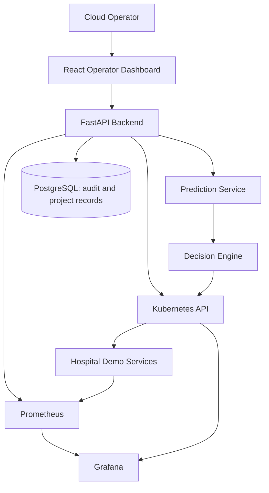

# Architecture

## System boundary

The project is a local prototype for a hospital cloud administrator or infrastructure operator. It is not a patient-facing hospital information system and does not process real healthcare data.

## Logical flow

## Core responsibilities

| Component | Responsibility |
|---|---|
| Demo services | Generate synthetic request traffic and expose health endpoints |
| Docker | Package services as reproducible images |
| Kubernetes | Run, discover, restart, distribute, and scale workloads |
| Prometheus | Collect and query time-series metrics |
| Metrics Server | Provide resource metrics for Kubernetes autoscaling |
| Grafana | Visualize cluster and workload behavior |
| FastAPI | Integrate Kubernetes, Prometheus, ML, decisions, and dashboard clients |
| LSTM pipeline | Predict near-future workload from historical metrics |
| Decision engine | Convert current and predicted state into bounded actions |
| PostgreSQL | Store users, predictions, decisions, scaling events, optimization results, and logs |
| React | Present operator-facing status, predictions, actions, and recommendations |

## Safety boundaries

Automatic scaling will be disabled until recommendation mode, cooldowns, bounded replica changes, dependency failure behavior, and baseline comparisons have been tested. The optimizer will initially make recommendations rather than replace the Kubernetes scheduler.
